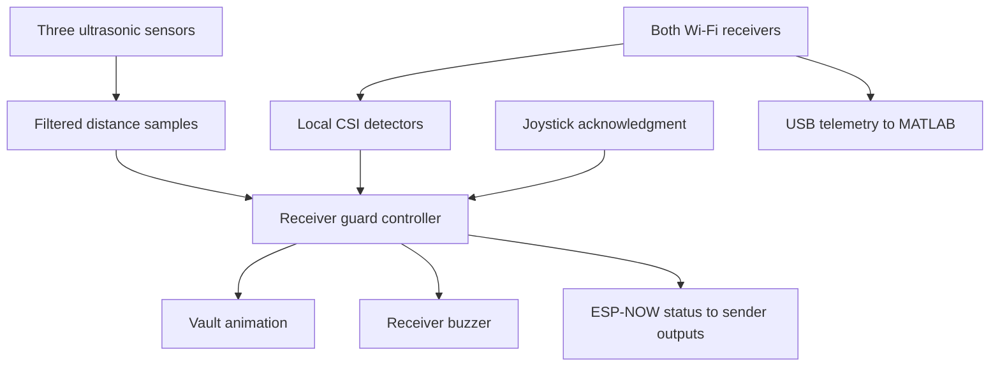
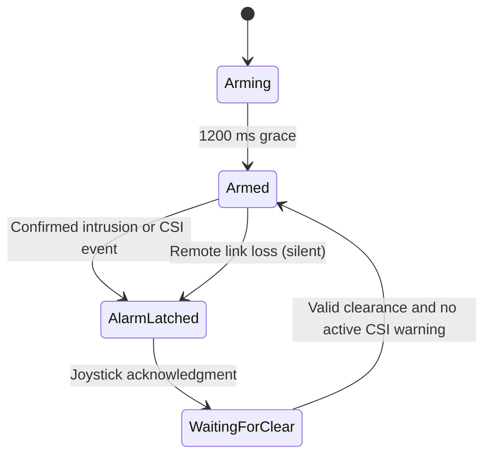

# Architecture

In THE VAULT, the receiver makes all the security decisions. Meanwhile, the sender measures two distances, runs its own CSI motion detection and sends this information to the receiver. It also follows the receiver’s instructions for its buzzer and LED, so both nodes respond to the same alarm state. Alongside this, MATLAB receives selected CSI amplitudes over USB and independently checks for motion.

## Execution and concurrency

Each ESP32 has a `setup()` function that runs once and a `loop()` that keeps repeating. Within this loop, the program takes turns filtering readings, making decisions, updating sound and drawing the display. However, Arduino and ESP-IDF also run background tasks, so the main loop is not the only code running on the board.

While the loop is running, GPIO interrupts capture the ultrasonic echo edges, and Wi-Fi callbacks copy incoming packets and CSI data into protected buffers. The loop then processes this information when it reaches the relevant functions. This allows the system to handle incoming data without creating additional application worker tasks.

The radio queue can hold eight packets. If it fills up, the oldest packet is dropped. On the receiver, this resets remote sensor confirmation; on the sender, it means the receiver’s status is no longer trusted until a valid newer reply arrives. CSI has only one pending frame, so a newer frame can overwrite one that has not yet been processed. As a result, a single usable CSI sample can trigger the alarm after calibration, but this does not mean every brief physical movement will be captured.

Locks protect shared data while it is being copied. However, drawing, serial printing and signal-processing calculations happen outside these locks. The program also refreshes its clock readings after handling callback data, so a newly received sample is not compared against an older loop timestamp. Unsigned subtraction handles normal 32-bit clock wraparound.

The animations use elapsed time instead of blocking animation loops. However, startup calibration includes waits, and the program stops if the display buffer cannot be allocated. There is also a 10 µs ultrasonic trigger pulse, a 1 ms loop yield and library I/O that may take time. Therefore, the actual loop duration would need to be measured before claiming a guaranteed response time.

## Guard and vault state machines

The guard controller decides whether the system is armed, alarmed or waiting for clearance. Meanwhile, a separate state machine controls the diamond and shutters.

After startup, the system allows a 1,200 ms arming grace period. Once armed, ultrasonic intrusion requires 140 ms of confirming samples. The shared alarm distance defaults to 30 cm, although it can be adjusted from 10–100 cm in 5 cm steps.

Pressing the joystick button acknowledges the alarm and stops the siren, but it does not immediately reopen the vault. Before that can happen, all three ultrasonic sensors must provide valid readings at least 5 cm beyond the alarm boundary, with 600 ms of confirmation. Invalid or missing echoes cannot count as clearance.

To prevent repeated packets from being treated as new measurements, each sensor has a sample counter. Additionally, the reported sample age and time spent waiting in the receiver’s queue must add up to less than 350 ms. The receiver estimates when a remote measurement happened by subtracting its reported age from its arrival time. However, this does not synchronize the board clocks or account for unknown radio transmission time.

The vault animation moves through Displaying → Retracting → Sealing → Sealed, then Opening → Raising → Displaying. Diamond movement takes 420 ms, while shutter movement takes 260 ms. Once fully sealed, the vault stays that way for at least 120 ms before reopening can begin.

Because the animation is separate from acknowledgment, pressing the button early cannot interrupt sealing. Similarly, if a new intrusion happens during reopening, the animation reverses from its current position. The diamond is not drawn whenever the shutters remain even partly closed.

Opening settings does not stop monitoring, and an intrusion brings the alarm scene back into view. However, settings can pause reopening. If the remote heartbeat disappears while the system is armed, the vault seals silently; a confirmed intrusion can then turn this silent fault into an audible alarm.

For CSI, an active motion warning prevents recovery. However, if CSI is unavailable, disabled or still calibrating, the current code allows recovery using ultrasonic clearance alone. This means that having no CSI warning is not always the same as having confirmed that the wireless environment is quiet.

## ESP-NOW communication

Both boards use Wi-Fi station mode and communicate through ESP-NOW broadcast on channel 1, so no router is required. For CSI sensing, the setup selects an 802.11n rate and collects a 128-byte LLTF field, from which the application uses 24 selected subcarrier amplitudes.

The `WirelessPacket` structure is 68 bytes and uses protocol version 4. Both boards define the same layout, and a compile-time check verifies its size. Packet identifiers and validation help reject unrelated message formats, while the first accepted peer MAC address is remembered for that boot.

Boot sessions distinguish restarts. Meanwhile, packet, sensor and status sequence numbers help reject duplicate or out-of-order information. These checks prevent old evidence from being treated as a new reading.

When a transmission finishes, the send callback only confirms that the send attempt has completed. It does not prove the other program processed the message. For that reason, the receiver sends an application acknowledgment, or ACK, which echoes the sender’s sample sequence and includes the receiver’s current status.

The sender transmits approximately every 70 ms. Its ultrasonic sensors also take turns pinging every 70 ms, so each individual sensor updates approximately every 140 ms. Receiver status is sent periodically and when the state changes. Using the reported elapsed time, the sender reconstructs the siren phase so its buzzer follows the receiver’s alarm. If communication is lost during an already latched alarm, the sender keeps that alarm active.

The current broadcast protocol has no encryption or cryptographic authentication. Although the identifiers, MAC address, sessions and sequence numbers filter messages, they do not stop someone capable of constructing matching packets. This communication method remains suitable for the current demonstration rather than a secure deployment.

## CSI processing

For each selected subcarrier, the program calculates the magnitude using `sqrt(real² + imaginary²)`. It then divides each magnitude by the mean of all 24 amplitudes, which reduces the effect of uniform receiver-gain changes.

Next, it compares this normalized pattern with the previous one. The mean absolute difference, multiplied by 100, becomes the instantaneous motion score. During calibration, at least ten seconds and 80 comparisons are used to learn the baseline. The threshold is then calculated as:

`threshold = max(minimum, baseline mean + multiplier × baseline standard deviation)`

Both firmware detectors use a minimum of 2 and a multiplier of 2. After calibration, one processed score strictly above the threshold can trigger the alarm. The motion indication is then held for two seconds so it can be reported, while stale CSI data resets calibration.

MATLAB runs a separate detector using a minimum of 10 and a multiplier of 10. It also smooths the score with a weight of 0.25 and requires three consecutive qualifying changes. Therefore, its results can differ from the firmware’s results. MATLAB is used for independent observation and analysis; it does not send alarm or clearance commands to either board.

API reference: [Espressif ESP-NOW documentation for ESP-IDF 4.4.7](https://docs.espressif.com/projects/esp-idf/en/v4.4.7/esp32/api-reference/network/esp_now.html). The behaviour described here comes from this project’s implementation, rather than being guaranteed by ESP-NOW itself.
