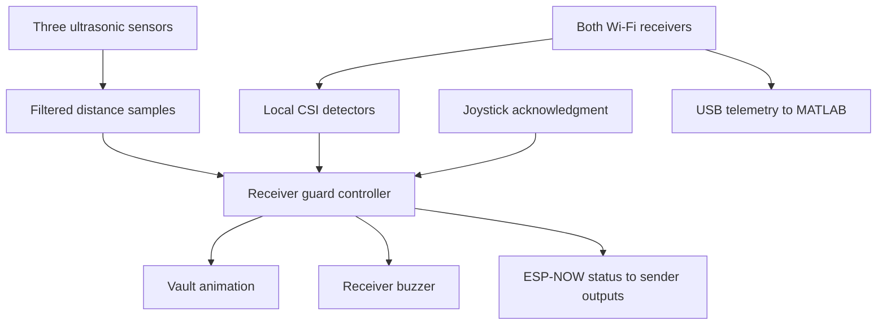
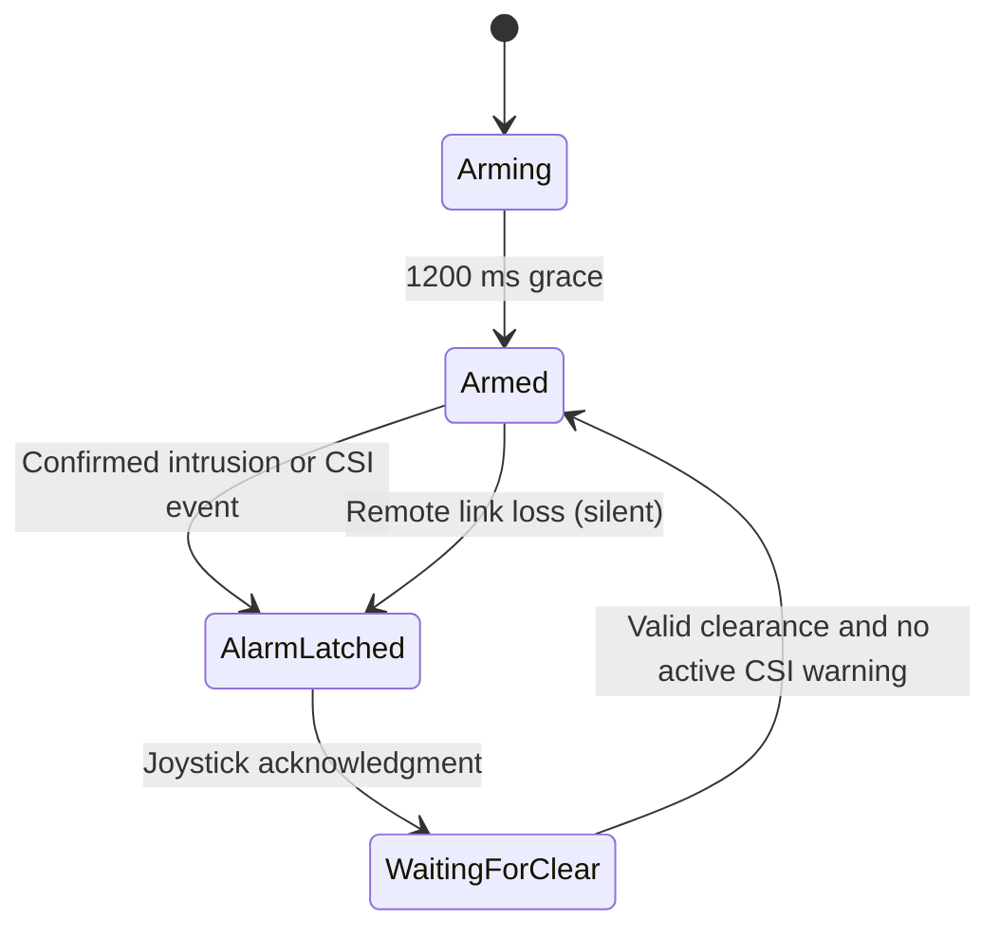

# Architecture

The receiver owns the security decision. The sender measures two distances, performs its own CSI detection, sends their status and mirrors the receiver's siren/LED instructions. MATLAB observes selected CSI amplitudes over USB and independently evaluates motion.

## Execution and concurrency

Each board has one application `setup()` and a cooperative `loop()`. Arduino/ESP-IDF runs framework tasks underneath. GPIO interrupts capture ultrasonic pulse edges; Wi-Fi callbacks copy incoming packets and CSI into protected buffers. The application loop performs filtering, decisions, sound scheduling and drawing. No additional application worker task is created.

The radio queue holds eight packets and drops the oldest on overflow. Receiver overflow resets remote confirmation; sender overflow makes receiver status untrusted until a valid newer reply. CSI uses one pending frame, so a newer frame can replace an unprocessed one. A single **processed, usable, calibrated** CSI sample can trigger an alarm; arbitrary physical spikes are not guaranteed to be captured.

Locks protect shared state while copying it. They do not cover drawing, serial printing or signal-processing calculations. After consuming callback data, clock snapshots are refreshed so unsigned age calculations do not compare a new sample against an older loop timestamp. Unsigned subtraction still supports normal 32-bit clock wrap.

Normal animation has no blocking loop. There are deliberate startup calibration waits, a fatal display-allocation wait, a 10 µs ultrasonic trigger pulse, a 1 ms loop yield and potentially blocking library I/O. Measure total loop time before claiming a hard real-time bound.

## Guard and vault are separate state machines

Ultrasonic intrusion needs 140 ms of confirming samples. Recovery requires each sensor's valid readings at least 5 cm beyond the shared boundary and 600 ms confirmation. The boundary defaults to 30 cm and is adjustable from 10–100 cm in 5 cm steps. Invalid echoes cannot confirm clearance. Sample counters prevent repeated packets from creating new sensor evidence; sample age plus receiver queue time must remain below 350 ms.

Radio-derived measurement timestamps estimate when a remote measurement occurred by subtracting its reported age from arrival time. They do not remove unknown one-way radio latency or synchronize the two board clocks.

The vault goes from Displaying → Retracting → Sealing → Sealed, then Opening → Raising → Displaying. Diamond travel takes 420 ms, shutters 260 ms, and a completed seal is shown for at least 120 ms before reopening. Early acknowledgment cannot stop sealing. A new intrusion during reopening reverses motion from the current position. Drawing suppresses the diamond whenever any shutter closure remains.

Settings do not suspend sensing. An intrusion returns to the alarm scene; settings can pause reopening. A missing remote heartbeat while armed silently seals the vault. A confirmed intrusion can escalate this silent fault into an audible alarm.

**CSI fallback policy:** recovery is blocked by an active CSI warning, but unavailable, disabled or calibrating CSI is not affirmative proof of quiet. The current application permits ultrasonic-only recovery in those states. This policy is preserved and explicitly documented, not silently strengthened by the review.

## ESP-NOW protocol

Both nodes use station mode and ESP-NOW broadcast on channel 1. No router is required. CSI setup selects an 802.11n rate and collects a 128-byte LLTF field. The application uses 24 selected subcarrier amplitudes.

`WirelessPacket` is 68 bytes, protocol version 4. Each header contains the same layout and a compile-time size check. Identifiers and validation reject unrelated formats; the first accepted peer MAC is remembered for the boot. Boot sessions distinguish restarts; packet, sensor and status sequence numbers reject duplicate or reordered evidence. A transport send callback means a send attempt finished, not that the other application acted on it. Application ACKs echo the sender sample sequence and carry authoritative receiver status.

The sender transmits about every 70 ms. Its ultrasonic pings alternate every 70 ms, so each remote sensor updates about every 140 ms. Receiver status is periodic and also sent for state changes. The remote buzzer reconstructs the receiver's siren phase from elapsed time; it retains an already latched alarm if contact is lost.

The broadcast protocol has no encryption or cryptographic authentication. Magic, network ID, MAC, session and sequence checks do not prevent a capable attacker from constructing packets. This release preserves the existing bench-demo protocol.

## CSI processing

For each chosen bin, magnitude is `sqrt(real² + imaginary²)`. Divide each magnitude by the mean of all 24 to reduce uniform receiver-gain changes. The instantaneous score is the mean absolute difference between consecutive normalized vectors, multiplied by 100. Ten seconds and at least 80 comparisons establish a baseline; threshold = max(minimum, baseline mean + multiplier × baseline standard deviation).

Both firmware detectors use minimum 2 and multiplier 2, trigger on one strictly above-threshold score, and hold motion for two seconds for reporting. Stale CSI resets calibration. MATLAB intentionally uses minimum 10 and multiplier 10, smooths the score with weight 0.25 and requires three consecutive qualifying changes. Its result is independent analysis, not an alarm command.

Primary API reference: [Espressif ESP-NOW documentation for ESP-IDF 4.4.7](https://docs.espressif.com/projects/esp-idf/en/v4.4.7/esp32/api-reference/network/esp_now.html). The architecture above describes this repository's implementation rather than a guarantee made by the wireless API.
