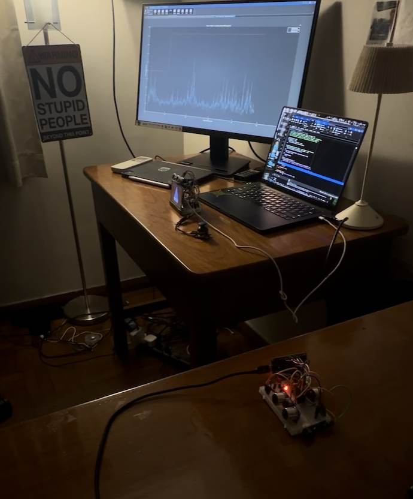

# THE VAULT (Test results)

This record separates successful firmware uploads from physical behaviour. The build and upload results below come from the supplied terminal logs, while the remaining sections are left for observations from the assembled system.

## 1. Test setup

| Item                                   | Record                                                                                                                   |
| -------------------------------------- | ------------------------------------------------------------------------------------------------------------------------ |
| Test date and time                     | 14/10/2026                                                                                                               |
| Tester                                 | Unt Hpone Aung                                                                                                           |
| Receiver commit / local changes        | No Local Changes                                                                                                         |
| Sender commit / local changes          | No Local Changes                                                                                                         |
| MATLAB commit / local changes, if used | No Local Changes                                                                                                         |
| Alarm boundary                         | 30 cm                                                                                                                    |
| Sound setting                          | Enables                                                                                                                  |
| Receiver and sender power supplies     | MacBook for Receiver and a powerbank for the sender                                                                      |
| Environment                            | Bedroom with AC                                                                                                          |
| Setup photograph / wiring reference    |                                                                     |
| Physical-test video                    | [https://youtube.com/shorts/hcL8IggtzgA?si=_hTWbxHjIqKAPc4q](https://youtube.com/shorts/hcL8IggtzgA?si=_hTWbxHjIqKAPc4q) |

## 2. Build and upload — completed

Evidence: PlatformIO logs supplied on **14 October 2026**. Both logs end with `[SUCCESS]`, verified flash-write hashes and a reset command; however, this does not establish successful application startup or sensor operation.

| Item                          | Receiver                          | Sender                            |
| ----------------------------- | --------------------------------- | --------------------------------- |
| Build and upload              | **PASS**                          | **PASS**                          |
| ESP32 MAC reported by esptool | `8c:94:df:4d:4e:10`               | `8c:94:df:57:57:7c`               |
| Chip                          | ESP32-D0WD-V3, revision v3.1      | ESP32-D0WD-V3, revision v3.1      |
| Board / platform              | `esp32dev` / `espressif32@6.9.0`  | `esp32dev` / `espressif32@6.9.0`  |
| Arduino framework package     | `3.20017.241212+sha.dcc1105b`     | `3.20017.241212+sha.dcc1105b`     |
| esptool                       | 4.5.1                             | 4.5.1                             |
| Xtensa toolchain              | `8.4.0+2021r2-patch5`             | `8.4.0+2021r2-patch5`             |
| TFT_eSPI                      | 2.5.43                            | Not used                          |
| Serial upload port shown      | `/dev/cu.usbserial-0001`          | `/dev/cu.usbserial-0001`          |
| Static RAM reported           | 48,948 / 327,680 bytes (14.9%)    | 45,812 / 327,680 bytes (14.0%)    |
| Program flash usage reported  | 826,037 / 1,310,720 bytes (63.0%) | 752,249 / 1,310,720 bytes (57.4%) |
| Firmware image bytes written  | 832,608 bytes                     | 758,832 bytes                     |
| Total PlatformIO task time    | 25.25 s                           | 51.38 s                           |
| Upload-log file               | [save log and enter filename]     | [save log and enter filename]     |

The different MAC addresses identify two different ESP32s despite the repeated serial-port name. Static RAM figures are build-time allocations, not measured runtime free memory, and flash percentages use the application partition rather than the entire 4 MB chip. The task times are build/upload times, not alarm response times.

## 3. Physical test checklist

Uses **Not run**, **Pass**, **Fail** or **Inconclusive**. 

| ID  | Test action                                                                                           | Expected behaviour                                                                                                            | Result |
| --- | ----------------------------------------------------------------------------------------------------- | ----------------------------------------------------------------------------------------------------------------------------- | ------ |
| T01 | Start both boards and finish any joystick calibration                                                 | LCD scene appears, radio link becomes fresh, guard arms and both CSI detectors eventually show ready                          | Pass   |
| T02 | Bring a target inside the local ultrasonic boundary                                                   | Local sensor is identified; vault seals and both buzzers sound when enabled                                                   | Pass   |
| T03 | Bring a target inside remote sensor 1's boundary                                                      | Remote sensor 1 is identified; vault seals and both buzzers sound                                                             | Pass   |
| T04 | Repeat for remote sensor 2                                                                            | Remote sensor 2 is identified; vault seals and both buzzers sound                                                             | Pass   |
| T05 | Remove the target after an alarm without acknowledging                                                | Alarm remains latched and vault stays sealed                                                                                  | Pass   |
| T06 | Acknowledge while the diamond is still retracting or shutters are closing                             | Both sirens stop after the status update, but sealing completes and the diamond does not reappear early                       | Pass   |
| T07 | Acknowledge while a target remains close                                                              | Sirens stop, but vault remains sealed; sender LED indicates waiting for clearance                                             | Pass   |
| T08 | After acknowledgment, provide valid clearance on all three sensors and allow CSI warnings to end      | System rearms and vault reopens only once recovery conditions are satisfied                                                   | Pass   |
| T09 | After acknowledgment, make one sensor return an invalid/missing echo                                  | Invalid readings prevent clearance; record which sensor was tested and repeat for the others                                  | Pass   |
| T10 | Introduce a new intrusion while the vault is reopening                                                | Alarm returns and animation reverses towards sealing                                                                          | Pass   |
| T11 | Trigger an intrusion with settings open                                                               | Monitoring continues and the alarm scene takes over                                                                           | Pass   |
| T12 | Mute sound, then trigger an intrusion                                                                 | Both buzzers stay silent, MUTE is indicated and visual sealing still occurs                                                   | Pass   |
| T13 | While armed, switch off the sender, then restore it                                                   | Receiver seals silently on link loss; reconnection alone does not bypass acknowledgment and valid clearance                   | Pass   |
| T14 | Start an audible alarm, then switch off the receiver while leaving the sender powered                 | Sender retains its commanded alarm, record recovery after the receiver restarts                                               | Pass   |
| T15 | During CSI trials, observe an event attributed to main CSI while all ultrasonic readings remain clear | Receiver reports the CSI cause, seals and commands both sirens when sound is enabled                                          | Pass   |
| T16 | Repeat for an event attributed to remote CSI                                                          | Remote CSI can produce the same shared alarm response                                                                         | Pass   |
| T17 | Hold and release sender BOOT after startup                                                            | Both reported remote distances become 5 cm while held, release restores the selected mode, but does not acknowledge the alarm | Pass   |
| T18 | Change distance/sound settings, save, then restart the receiver                                       | Saved settings return; restore the chosen test settings afterwards                                                            | Pass   |

For T02–T04, record the displayed cause. If CSI triggers first, the ultrasonic trigger test is **inconclusive**, not a demonstrated pass. Similarly, T15/T16 require evidence of the named detector: record a combined CSI event separately rather than treating it as an isolated detector test.

## 4. CSI observations

Keep ultrasonic readings valid and beyond the clearance boundary, then record a stationary period and repeated movement along one marked path. Record both detectors independently where possible; their radio paths are related, so a physical movement may affect either or both.

### Stationary period

| Item                                                | Record                                                |
| --------------------------------------------------- | ----------------------------------------------------- |
| Usable observation duration                         | 5 minutes                                             |
| Main / remote CSI thresholds after calibration      | 17.29, then 19.09, then 26.36 following recalibration |
| Alarm activations during intended stationary time   | once                                                  |
| Unplanned movement, acknowledgment or recalibration | Moved my hands                                        |

